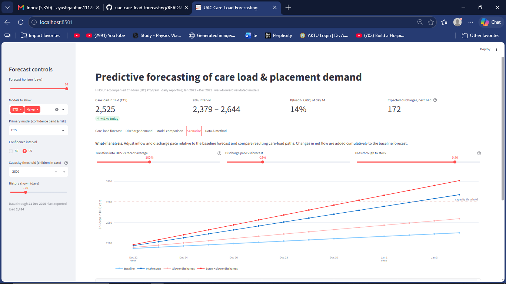
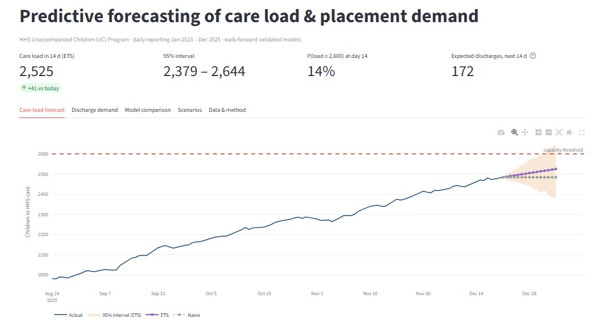
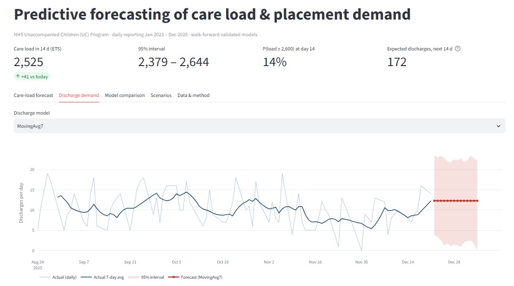
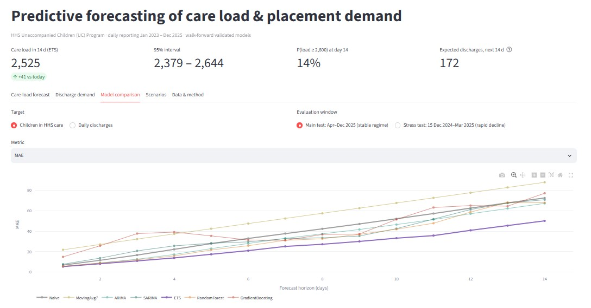
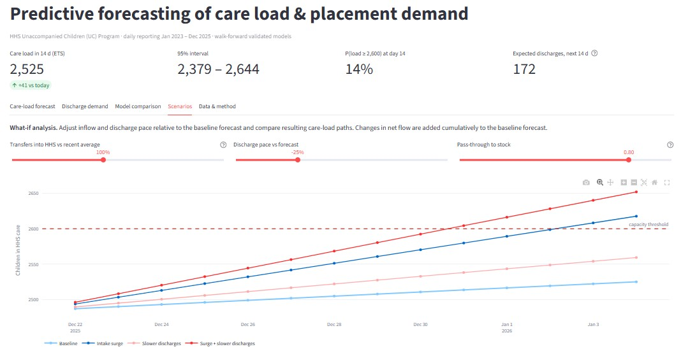

# UAC Program – Predictive Forecasting of Care Load & Placement Demand

<p align="center">
  <b>Predictive Analytics | Time-Series Forecasting | Machine Learning | Streamlit Dashboard</b>
</p>

## 📌 Project Overview

The **UAC Program – Predictive Forecasting of Care Load & Placement Demand** is a data-driven forecasting project focused on analyzing and predicting future care load and discharge demand within the U.S. Department of Health and Human Services (HHS) Unaccompanied Children (UC) Program.

The project uses historical daily operational data to forecast the number of children in HHS care and estimate future discharge demand. It combines statistical forecasting, machine learning, exploratory data analysis, and interactive visualization to support capacity planning and operational decision-making.

The solution includes multiple forecasting models, walk-forward backtesting, prediction intervals, model performance evaluation, and an interactive Streamlit dashboard.

# 📊 Data Visualizations

## Dashboard



## Care-load forecast



## Discharge demand



## Model comparison



## Scenarios




## 🎯 Project Objectives

- Analyze historical UAC program data and identify operational trends.
- Forecast future HHS care load over a 14-day horizon.
- Predict daily discharge demand.
- Compare statistical and machine learning forecasting models.
- Evaluate forecasting accuracy using historical backtesting.
- Estimate capacity-breach probabilities and identify potential operational risks.
- Present forecasting insights through an interactive dashboard.

## 📂 Dataset Information

**Dataset:** HHS Unaccompanied Alien Children Program

**Data file:** `data_raw.csv`

The dataset contains daily operational indicators, including:

| Column | Description |
|---|---|
| Date | Daily reporting date |
| Apprehended | Number of children apprehended |
| CBP Custody | Children in Customs and Border Protection custody |
| Transferred | Number of children transferred |
| HHS Care | Number of children in HHS care |
| Discharged | Number of children discharged from care |

**Historical coverage:** January 2023 – December 2025.

## 🛠️ Technology Stack

| Technology | Purpose |
|---|---|
| Python | Core programming and analysis |
| Pandas | Data cleaning and manipulation |
| NumPy | Numerical computation |
| Scikit-learn | Machine learning models |
| Statsmodels | Statistical forecasting |
| Matplotlib | Data visualization |
| Plotly | Interactive charts |
| Streamlit | Interactive forecasting dashboard |

## 📊 Forecasting Models

The project compares seven forecasting approaches:

1. **Naive Forecasting** – Uses the latest observed value as the forecast.
2. **Moving Average (7 Days)** – Uses the previous seven days' average.
3. **ARIMA** – Statistical time-series forecasting.
4. **SARIMA** – Seasonal time-series forecasting.
5. **ETS (Exponential Smoothing)** – Captures trends using exponential smoothing.
6. **Random Forest Regressor** – Machine learning model using historical and engineered features.
7. **Gradient Boosting Regressor** – Ensemble learning model for predicting future demand.

The models are evaluated separately for HHS care load and discharge demand.

## 🔍 Project Workflow

### 1. Data Preprocessing
- Load historical UAC program data.
- Remove empty records and duplicate dates.
- Convert date and numerical columns into appropriate formats.
- Reindex the dataset to a continuous daily frequency.
- Handle missing observations through interpolation.
- Engineer operational indicators such as net pressure and care-load change.

### 2. Exploratory Data Analysis (EDA)
- Examine historical care-load patterns.
- Analyze discharge and transfer trends.
- Identify fluctuations in operational demand.
- Explore relationships between important variables.
- Generate statistical summaries and visualizations.

### 3. Feature Engineering
Develop forecasting features using:
- Historical care-load changes.
- Previous discharge values.
- Rolling averages and variances.
- Net transfer pressure.
- Apprehension and custody trends.
- Day of the week and month.
- U.S. federal holiday indicators.

### 4. Predictive Forecasting
- Train statistical and machine learning models.
- Generate forecasts for a 14-day horizon.
- Apply expanding-window walk-forward backtesting.
- Compare model performance across different forecast horizons.
- Generate final forecasts for care load and discharge demand.

### 5. Model Evaluation
Evaluate models using:

- MAE – Mean Absolute Error.
- RMSE – Root Mean Squared Error.
- MAPE – Mean Absolute Percentage Error.
- Prediction interval coverage.
- Brier Score for capacity-breach probability.
- Forecast stability and stress-period performance.

### 6. Dashboard Development
Build an interactive Streamlit dashboard to display forecasting results, model comparisons, operational scenarios, and key performance indicators.

## 📈 Dashboard Features

The Streamlit application provides five main sections:

**1. Care-Load Forecast**
- Historical versus predicted care load.
- Forecast horizon selection.
- Model comparison.
- 80% and 95% prediction intervals.
- Capacity threshold and breach probability.
- Early-warning risk status.

**2. Discharge Demand**
- Historical discharge trends.
- Predicted daily discharges.
- Cumulative discharge forecasts.
- Prediction intervals.

**3. Model Comparison**
- Compare forecasting models.
- Review prediction errors.
- Evaluate performance across forecast horizons.

**4. Scenarios**
- Explore operational demand and capacity-related scenarios.

**5. Data & Method**
- Review dataset information.
- Understand forecasting methodology.
- Examine the analytical approach.

## 📁 Repository Structure

```text
uac-care-load-forecasting/
├── figures/
│   ├── dashboard.png
│   ├── care-load.png
│   ├── discharge-demand.png
│   └── model-comparison.png
├── src/
├── app.py
└── README.md
```

## 🚀 Installation & Execution

### Step 1: Clone the Repository

```bash
git clone https://github.com/Ayush-Gautam11122/uac-care-load-forecasting.git
```

### Step 2: Navigate to the Project

```bash
cd uac-care-load-forecasting
```

### Step 3: Install Dependencies

```bash
pip install -r requirements.txt
```

### Step 4: Run Data Preprocessing

```bash
python src/prep.py
```

### Step 5: Perform Exploratory Data Analysis

```bash
python src/eda.py
```

### Step 6: Run Forecasting Models

```bash
python src/forecast.py
```

### Step 7: Evaluate Model Performance

```bash
python src/metrics.py
```

### Step 8: Generate Result Visualizations

```bash
python src/figs2.py
```

### Step 9: Launch the Streamlit Dashboard

```bash
streamlit run app.py
```

**Note:** Run the scripts in the specified order. The dashboard requires the precomputed files in the `results/` directory.

## 📅 Backtesting Strategy

The project uses walk-forward validation to evaluate forecasting performance over historical periods.

| Evaluation | Period |
|---|---|
| Main Test Period | April 1 – December 21, 2025 |
| Stress Test Period | December 15, 2024 – March 31, 2025 |
| Forecast Horizon | Up to 14 days |
| Model Evaluation | MAE, RMSE, MAPE and additional KPIs |

This approach evaluates forecasting performance using historical observations while maintaining the chronological order of the data.

## 💼 Business Applications

The project demonstrates how predictive analytics can help operational teams:

- Anticipate future care-load requirements.
- Estimate upcoming discharge demand.
- Improve capacity planning.
- Identify potential capacity-related risks.
- Support resource allocation decisions.
- Monitor operational trends through data visualization.

## 🔮 Future Enhancements

- Integrate additional external operational indicators.
- Experiment with advanced time-series forecasting techniques.
- Improve forecasting accuracy through feature optimization.
- Develop automated reporting and forecasting pipelines.
- Enhance interactive dashboard functionality.
- Incorporate additional placement-related demand indicators when available.

## ⚠️ Disclaimer

This project is intended for analytical, forecasting, and educational purposes. Forecasts and capacity-risk estimates are decision-support indicators, not official operational projections. The illustrative capacity threshold should not be interpreted as an official HHS capacity limit.

## 👨‍💻 Author

**Ayush Gautam**

Aspiring Data Analyst | Python | SQL | Power BI | Machine Learning | Predictive Analytics

**GitHub:** https://github.com/Ayush-Gautam11122

---

⭐ If you find this project interesting, consider giving the repository a star!
